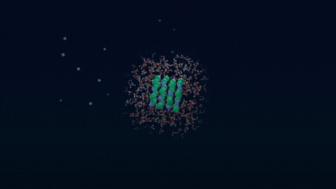

# MGE Skills

[English](README.md) · **Português**

Skills de agente para química computacional e divulgação científica, criadas durante trabalho
real de pesquisa. Cada pasta é uma skill independente (um `SKILL.md` com referências, modelos e
scripts) que o Claude Code, ou qualquer agente que leia `SKILL.md`, pode carregar.

| Skill | O que faz |
|---|---|
| [`molecular-motion-video`](molecular-motion-video/) | Vídeos narrados de motion graphics, cientificamente corretos, sobre moléculas, materiais e reações (Blender/Cycles). **Os átomos se movem segundo cálculos reais**: trajetórias de dinâmica molecular, caminhos de reação IRC/NEB e modos normais. Também cuida de narração local verificada em qualquer idioma, legendas palavra a palavra, rótulos guiados por dados, etapas de aprovação humana e conferência automática. |

## Vitrine

[](molecular-motion-video/examples/salt-dissolving/README.pt-BR.md)

*Salt dissolving*, feito com `molecular-motion-video`. Um nanocristal de NaCl se dissolve em água, e cada átomo segue uma trajetória real do OpenMM.

[](molecular-motion-video/examples/sn2-walden/README.pt-BR.md)

*SN2: the Walden inversion*, feito com `molecular-motion-video`. O Cl⁻ ataca o CH₃Br por trás, em água, e os átomos seguem uma trajetória real de GFN2-xTB lançada do estado de transição.

Novas skills entram como subpastas.

## Instalação (Claude Code)

```bash
git clone https://github.com/MrGoulart3/MGE-Skills.git ~/MGE-Skills
~/MGE-Skills/install.sh                          # liga todas as skills em ~/.claude/skills/
~/MGE-Skills/install.sh molecular-motion-video   # ou só uma
```

Para atualizar: `git -C ~/MGE-Skills pull` (os links simbólicos acompanham).

## Instalação rápida

```bash
cd ~/MGE-Skills/molecular-motion-video/env
conda env create -f environment-render.yml     # ou: micromamba create -f ...
conda env create -f environment-tts.yml
conda env create -f environment-calc.yml
# Exemplo Linux x86_64: tarball oficial do Blender 4.2 LTS
BLENDER_DIR=$HOME/blender; mkdir -p "$BLENDER_DIR"
curl -L https://download.blender.org/release/Blender4.2/blender-4.2.3-linux-x64.tar.xz | tar -xJ -C "$BLENDER_DIR" --strip-components=1
export BLENDER="$BLENDER_DIR/blender"
bash doctor.sh        # só verifica, não instala; mostra OK/MISSING
```

Cluster (opcional): copie `cluster/cluster.example.yaml` para `cluster.yaml` e use
`python3 cluster/run_remote.py submit <pasta_do_job> -- <comando>` (há `status`, `fetch`, `wait`, `--dry-run`).
Dicas de fluxo: `molecular-motion-video/references/iteration-loop.md`.

## Adapte ao seu ambiente

Os aliases de host e caminhos `/opt/...` de `cluster/cluster.example.yaml` são fictícios. Copie
para um `cluster.yaml` local e substitua pelos seus valores. Execute o runner nessa pasta ou
passe `--config /caminho/cluster.yaml` antes do subcomando. `--dry-run` mostra os comandos sem
conectar. Configurações locais, registros de jobs e trajetórias geradas são ignorados pelo Git.

| Configuração | Padrão | Como alterar |
|---|---|---|
| Diretório de instalação das skills | `~/.claude/skills` | `CLAUDE_SKILLS_DIR=/caminho/skills ./install.sh` |
| CPUs por job remoto | 4 | `threads` no `cluster.yaml` (exportado como `MMV_THREADS`) |
| Limite de admissão por carga remota | 60% | `max_cpu_percent`; carga média / CPUs, apenas com `scheduler: none`. Verifica o início, não limita o uso de CPU durante a execução. |
| Threads do exemplo OpenMM | 4 | `NT` (compatibilidade), depois `MMV_THREADS` |
| Threads das cenas Blender | 4 | `--threads N`; passe também `-t N` ao Blender |
| Processos de pós-produção | 2 | `--procs N` |
| Executáveis de mídia | `ffmpeg`, `ffprobe` no `PATH` | `FFMPEG`, `FFPROBE` (caminhos dos executáveis) |
| Fontes de legenda e símbolos | `DejaVuSans.ttf`, `DejaVuSans-Bold.ttf` | `FONT`, `SYMBOL_FONT` (nomes ou caminhos aceitos pelo Pillow; instale as fontes separadamente) |
| Música de fundo | Nenhuma | `MUSIC=/caminho/trilha-licenciada.wav`; a narração continua obrigatória |
| Verificação de recursos | 20 GB de disco, 8 GB de RAM | `MIN_DISK_GB`, `MIN_RAM_GB` para `env/doctor.sh` |

Os nomes dos ambientes conda em `env/*.yml` são padrões sugeridos. Execute cada comando no
ambiente apropriado; nenhum script exige um nome de ambiente particular. `ENV_RENDER`,
`ENV_TTS` e `ENV_CALC` selecionam os ambientes verificados pelo `doctor.sh`. Escolha execução
local/remota, concorrência e horários conforme seu hardware e sua alocação.
Os parâmetros científicos e resultados registrados nos exemplos descrevem aquelas
demonstrações; não são regras de máquina. A revisão científica humana (G1) e a aprovação da prévia (G2) continuam na skill.

Os nomes dos comandos em português foram preservados: `montar_sal.py` monta o vídeo do sal,
`montar_sn2.py` monta o vídeo de SN2; `--quadros` indica a pasta dos quadros de entrada,
`--saida` o MP4 de saída e `--teste` o autoteste. `md_sal.py` executa a MD do sal, `shots/resumo.json` resume os disparos,
e `ITERACAO_SAL2.md` contém notas de iteração do sal. Veja os comandos nos READMEs dos exemplos.

## Testes

```bash
python3 -m unittest discover -s molecular-motion-video/cluster -p 'test*.py' -v
python3 -m unittest discover -s molecular-motion-video/scripts -p 'test*.py' -v
```

Os testes de execução dos exemplos usam NumPy e Pillow do ambiente de render. Não exigem
Blender, acesso SSH ou uma nova simulação. Este repositório não possui suíte de testes Node.

## Princípios comuns
- **Ciência real primeiro:** geometria de dados cristalográficos ou calculados, movimento vindo de
  cálculos de fato, e cada afirmação listada com a fonte e validada por uma pessoa.
- **Do barato ao caro, com aprovação humana:** prévias antes de renders e cálculos finais.
- **Conferido com números:** cada etapa tem um modo de checagem que imprime o que o revisor precisa.

## Licença
MIT (veja `LICENSE`).

## Relacionados (Related)

- [MGE-AgentPortal](https://github.com/MrGoulart3/MGE-AgentPortal): acesso autenticado aos agentes pelo navegador e painel opcional de recursos do PC.
- [MGE-LocalCompute](https://github.com/MrGoulart3/MGE-LocalCompute): orçamento de recursos compartilhados, fila noturna e guarda térmica.
- [MGE-UAH-Orquestra](https://github.com/MrGoulart3/MGE-UAH-Orquestra): orquestração genérica de agentes, modelos de projeto e vigias determinísticos.
